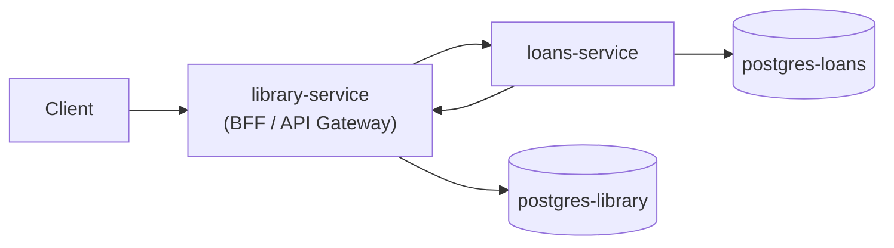

# Análisis del proyecto — Library System

Análisis del proyecto completo, basado en el código y la documentación del repo.

---

## 1. Decisiones razonadas: responsabilidad por servicio

La división sigue el criterio **"cada servicio es dueño de su dominio y de su base de datos"**, con un **punto de entrada único** para el cliente.

### library-service (NestJS) — catálogo, identidad y fachada

| Responsabilidad | Por qué aquí |
|-----------------|--------------|
| Autenticación (login, JWT, roles) | Es el único servicio expuesto al cliente; centraliza quién puede hacer qué. |
| Usuarios (CRUD, bcrypt) | Los usuarios pertenecen al dominio "biblioteca"; loans solo guarda `user_id` como referencia lógica, sin FK cross-DB. |
| Libros (CRUD, filtros, paginación) | El inventario (`available_copies`) es **fuente de verdad** del catálogo. |
| `PATCH /books/:id/copies` | Operación interna atómica para préstamos/devoluciones; protegida con JWT `role: "service"`. |
| Proxy de `/loans/*` | El cliente no habla con loans-service; library valida el DTO y reenvía. |

El módulo `loans` en NestJS **no tiene entidad ni DB**: es un proxy HTTP deliberadamente delgado.

### loans-service (Go) — ciclo de vida de préstamos

| Responsabilidad | Por qué aquí |
|-----------------|--------------|
| Crear / devolver préstamos | Dominio de préstamos aislado en su propia DB (`postgres-loans`). |
| Historial y préstamos activos por usuario | Consultas sobre la tabla `loans`; no necesita duplicar usuarios/libros. |
| Orquestación cross-service | Al crear/devolver, debe coordinar inventario (library) + registro (loans). |
| Validación de libro y copias | Llama a library-service porque **no es dueño** del inventario. |

### Lo que queda fuera (decisión implícita)

- **No hay validación de que `user_id` exista** en loans-service: se confía en que el cliente (vía library) envía IDs válidos.
- **loans-service no tiene auth propia**: asume que solo library-service lo llama. En Docker el puerto 8081 está expuesto; en producción habría que restringirlo a red interna.
- **No hay réplica de datos de libros/usuarios** en loans DB: evita acoplamiento de esquema, a costa de dependencia en runtime hacia library.

Esa separación es coherente para un sistema pequeño con **database-per-service** real (dos Postgres distintos en `docker-compose.yml`).

---

## 2. Comunicación entre servicios: errores, timeouts, caídas

Hay **dos direcciones** de comunicación HTTP síncrona:

```
Cliente → library-service → loans-service     (proxy de préstamos)
loans-service → library-service               (validar libro + actualizar copias)
```

### Timeouts

Ambos lados usan **5 segundos**:

```6:6:library-service/src/loans/loans.module.ts
    imports: [HttpModule.register({ timeout: 5000 })],
```

```25:25:loans-service/internal/clients/library_client.go
		httpClient: &http.Client{Timeout: 5 * time.Second},
```

No hay retries, circuit breaker ni bulkhead. Un timeout se trata como error inmediato.

### Si library-service está caído (desde loans-service)

Flujo de creación en `CreateLoan`:

1. `ValidateBook` → GET `/books/:id`
2. `UpdateCopies` → PATCH `/books/:id/copies` (decrement)
3. `repository.Create` → INSERT en loans DB

Errores de red se envuelven como `ErrLibraryServiceUnavailable`:

```53:56:loans-service/internal/clients/library_client.go
	resp, err := c.httpClient.Do(req)
	if err != nil {
		return nil, fmt.Errorf("%w: %w", ErrLibraryServiceUnavailable, err)
	}
```

El handler lo mapea a **503 Service Unavailable**:

```41:42:loans-service/internal/handler/errors.go
	case errors.Is(err, clients.ErrLibraryServiceUnavailable):
		writeErrorJSON(w, clients.ErrLibraryServiceUnavailable.Error(), http.StatusServiceUnavailable)
```

**Efecto para el usuario:** no se crea préstamo; si falla antes del decrement, no hay side effects. Si falla después del decrement pero antes del INSERT, entra la compensación (ver sección 3).

Otros códigos desde library:

- Libro inexistente → **404**
- Sin copias (`409` en `updateCopies` o check en `ValidateBook`) → **409 Conflict**

### Si loans-service está caído (desde library-service)

El proxy captura el error de Axios y devuelve el status del downstream o **500**:

```35:38:library-service/src/loans/loans.controller.ts
        } catch (err: any) {
            const status = err?.response?.status ?? HttpStatus.INTERNAL_SERVER_ERROR;
            const message = err?.response?.data ?? 'loans service error';
            throw new HttpException(message, status);
```

**Efecto:** el cliente ve error genérico o el status propagado; **no hay cola ni reintento**. Si library respondió OK en otra operación pero loans falló después de decrementar copias, el problema de consistencia queda en loans-service (compensación).

### Auth inter-servicio

loans-service firma un JWT efímero (`role: "service"`, 1 min) en cada llamada a library. library reutiliza `JwtAuthGuard` y el endpoint de copias exige ese rol:

```94:96:library-service/src/books/books.controller.ts
        if (req.user.role !== 'service') {
            throw new ForbiddenException('This endpoint is reserved for internal service use');
        }
```

Es una decisión pragmática: reutiliza la infraestructura JWT existente sin un mecanismo nuevo.

### Mapeo de errores (loans-service)

Capa handler centralizada con `errors.Is()` — buena práctica:

| Error de dominio | HTTP |
|------------------|------|
| Préstamo duplicado activo, ya devuelto, sin copias | 409 |
| Libro/préstamo no encontrado | 404 |
| Library no disponible | 503 |
| Resto | 500 |

---

## 3. Consistencia de datos entre servicios

**No hay transacciones distribuidas (2PC)** ni consistencia fuerte cross-DB. El modelo es **orquestación síncrona con acciones compensatorias** (fragmento de Saga):

### Crear préstamo

```35:52:loans-service/internal/service/loan_service.go
func (s *LoanService) CreateLoan(ctx context.Context, req model.CreateLoanRequest) (*model.Loan, error) {
	if _, err := s.libraryClient.ValidateBook(ctx, req.BookID); err != nil {
		return nil, err
	}

	if err := s.libraryClient.UpdateCopies(ctx, req.BookID, CopiesActionDecrement); err != nil {
		return nil, err
	}

	loan, err := s.repository.Create(ctx, req)
	if err != nil {
		if cErr := s.libraryClient.UpdateCopies(context.Background(), req.BookID, CopiesActionIncrement); cErr != nil {
			log.Printf("CRITICAL: compensation failed for book %d, user %d: %v (original error: %v)", req.BookID, req.UserID, cErr, err)
		}
		return nil, err
	}
	return loan, nil
}
```

Orden: **decrementar copias → insertar loan**. Si el INSERT falla → increment compensatorio.

### Devolver libro

Orden inverso lógico: **incrementar copias → marcar loan como `returned`**. Si el UPDATE falla → decrement compensatorio.

### Garantías locales (por servicio)

| Servicio | Garantía |
|----------|----------|
| library | `updateCopies` es atómico: `UPDATE ... WHERE available_copies + delta >= 0` evita copias negativas en concurrencia en el decrement. |
| loans | Índice único parcial impide dos préstamos activos del mismo user+book. |

```11:13:loans-service/db/schema.sql
CREATE UNIQUE INDEX IF NOT EXISTS idx_loans_active_user_book
    ON loans(user_id, book_id)
    WHERE status = 'active';
```

### Limitaciones conocidas (documentadas en README)

1. **Compensación best-effort:** si la llamada compensatoria también falla, queda inconsistencia (copias desincronizadas con préstamos). Solo hay `log.Printf("CRITICAL: ...")`; no outbox ni worker de reintento.

2. **Uso de `context.Background()` en compensación:** decisión acertada — el rollback debe ejecutarse aunque el contexto del request ya esté cancelado.

3. **TOCTOU en copias:** `ValidateBook` comprueba `available_copies > 0` **antes** del decrement atómico. Dos requests concurrentes pueden pasar la validación; el segundo decrement fallará con 409 gracias al UPDATE condicional, pero hubo una llamada HTTP extra innecesaria. El README lo reconoce como limitación.

4. **No es "eventual consistency" clásica:** no hay eventos, colas ni proyecciones. Es consistencia **síncrona con fallback manual**. En producción el README sugiere outbox pattern o saga coordinator.

5. **Referencias lógicas:** `user_id` y `book_id` en loans no tienen FK a library DB; un usuario/libro borrado en library dejaría préstamos huérfanos (no manejado).

---

## 4. Arquitectura: patrones, separación, escalabilidad

### Patrones identificables



| Patrón | Dónde |
|--------|-------|
| **API Gateway / BFF** | library-service concentra auth, validación y routing al cliente. |
| **Database per service** | Dos instancias Postgres independientes. |
| **Layered architecture** (Go) | `handler → service → repository` + `clients`. |
| **Dependency inversion** | `BookService` interface en service; `LibraryClient` la implementa. |
| **Factory** | `internal/app.go` construye pool → repo → service; `main.go` solo HTTP. |
| **Compensating transaction** | Saga manual en create/return. |
| **Strangler / proxy** | Módulo loans en NestJS sin lógica de negocio propia. |

### Separación de responsabilidades

- **Transporte vs dominio:** en Go, handlers no contienen SQL; en NestJS, controllers delegan a services (excepto loans, que delega a HTTP).
- **Constantes y errores por capa:** SQL en `repository/constants.go`, estados en `service/constants.go`, errores en `errors.go` de cada paquete.
- **Tests desacoplados:** interfaces mockeables; CI sin Docker ni DB.

### Escalabilidad

**A favor:**

- Servicios stateless (salvo DB); se pueden replicar horizontalmente.
- Bases de datos separadas permiten escalar lecturas/escrituras de préstamos vs catálogo de forma independiente.
- Pool pgx y queries explícitas en Go son predecibles bajo carga.

**Limitaciones:**

- Comunicación **HTTP síncrona** acopla latencias: crear préstamo = 2–3 round-trips mínimo (validate + decrement + insert, más el proxy client→library→loans).
- Sin caché, sin message broker, sin read replicas configuradas.
- Sin health-check entre servicios en compose (`depends_on` solo para Postgres, no library↔loans).
- El proxy no implementa bulkhead: si loans se satura, library también sufre.

Para el tamaño del proyecto la arquitectura es **adecuada y defendible**; escalaría mejor con gRPC/eventos si el volumen de préstamos creciera.

---

## 5. Calidad de código

### Fortalezas

**Go (loans-service)**

- Estructura clara y idiomática: paquetes con responsabilidad única.
- Inversión de dependencias bien aplicada (`LoanService` testeable con mocks).
- Mapeo HTTP centralizado en `writeServiceError`.
- SQL explícito legible; sin ORM que oculte comportamiento.
- Graceful shutdown en `main.go` (10s timeout).
- Nombres de dominio consistentes: `StatusActive`, `CopiesActionDecrement`, etc.

**NestJS (library-service)**

- Convenciones estándar: modules, DTOs, guards, Swagger.
- `ValidationPipe` global con whitelist — buen hardening en el borde.
- `updateCopies` atómico bien implementado.
- Tests unitarios en books y auth.

**Transversal**

- README extenso con decisiones técnicas y limitaciones honestas.
- Scripts e2e (`seed.sh`, `test_full.sh`) demuestran flujos reales.
- CI en GitHub Actions para ambos servicios.

### Áreas mejorables

| Área | Observación |
|------|-------------|
| **Duplicación en proxy** | `LoansController` repite el mismo `try/catch` en 4 métodos; podría extraerse un helper. |
| **`err: any`** | En el proxy NestJS pierde tipado; Axios tiene tipos de error más precisos. |
| **Naming** | `BookReturned` (service) vs `ReturnLoan` (handler) — funcional pero inconsistente. |
| **Seguridad loans** | Sin middleware de auth en Chi; depende de red/perimeter. |
| **Autorización préstamos** | Cualquier usuario autenticado puede consultar préstamos de otro `:userId` (documentado como gap). |
| **Validación de usuario** | Crear préstamo con `user_id` inexistente no falla en loans-service. |
| **`synchronize: true`** | Aceptable para evaluación; no para producción. |
| **Observabilidad** | Logs básicos (Chi logger); sin correlation IDs, métricas ni tracing distribuido. |

En conjunto, el código es **legible, bien estructurado para un assessment técnico**, con decisiones explícitas y trade-offs documentados. La parte más madura arquitectónicamente está en loans-service (capas, compensación, mapeo de errores); library-service cumple su rol de fachada con calidad estándar NestJS, con el módulo loans intencionalmente minimalista.

---

## Resumen ejecutivo

| Dimensión | Valoración |
|-----------|------------|
| División de responsabilidades | Clara y alineada con microservicios + DB por servicio. |
| Comunicación | HTTP síncrona, timeout 5s, errores mapeados; sin resiliencia avanzada. |
| Consistencia | Saga manual con compensación; no ACID distribuido; riesgo si falla el rollback. |
| Arquitectura | Patrones coherentes (BFF, capas, inversión de deps); escalable en teoría, acoplada en práctica por HTTP sync. |
| Calidad de código | Buena legibilidad y estructura; gaps conocidos en auth cross-user y validaciones cruzadas. |
